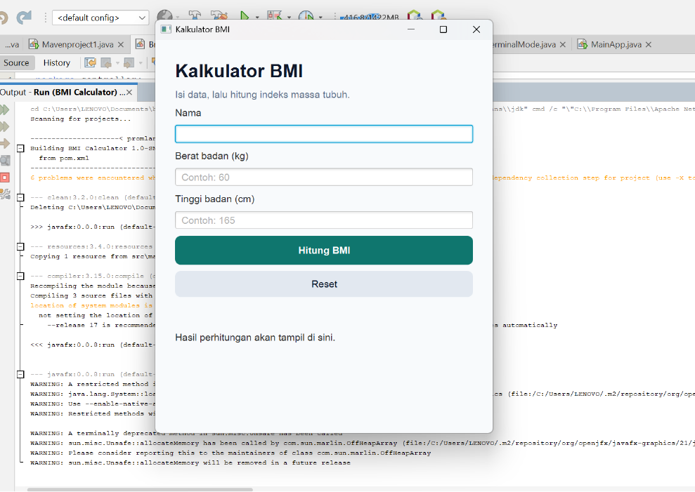
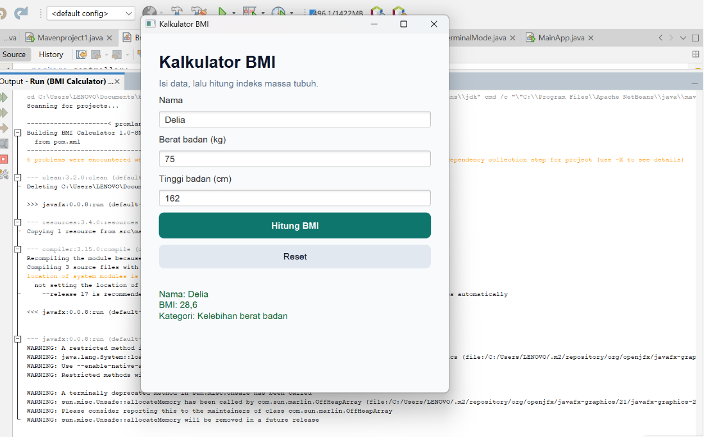
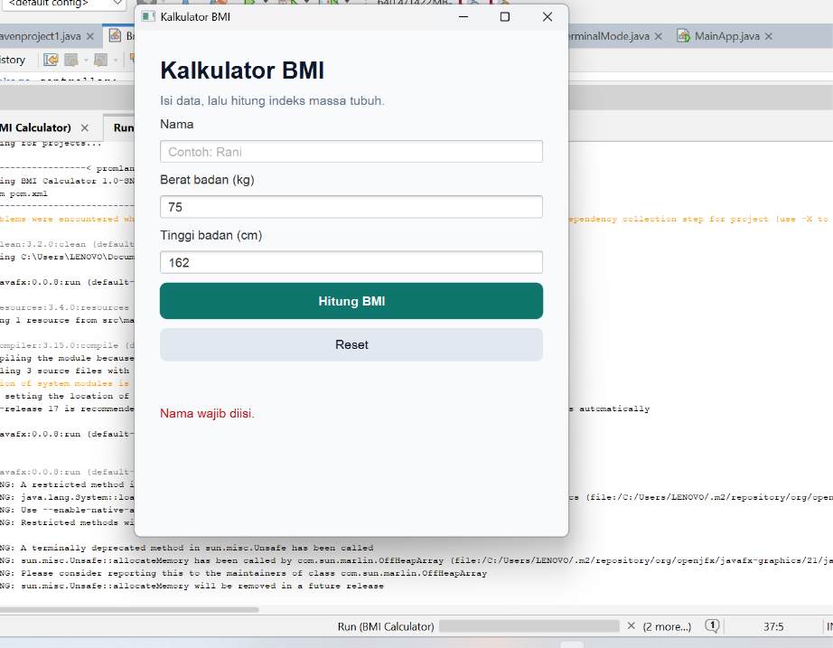

# BMI Calculator

Aplikasi desktop sederhana untuk menghitung Body Mass Index (BMI), dibuat dengan Java dan JavaFX sebagai tugas mata kuliah Pemrograman Berorientasi Objek.

Pengguna memasukkan nama, berat badan, dan tinggi badan. Aplikasi menampilkan nilai BMI beserta kategorinya.

## Fitur

- Input nama, berat badan, dan tinggi badan
- Hitung BMI dengan kategori WHO (Kurus, Normal, Kelebihan berat badan, Obesitas)
- Tombol Reset
- Validasi input (kosong, huruf, atau angka nol)

## Cara Menjalankan

**Kebutuhan:** JDK 17 atau lebih baru, NetBeans, dan koneksi internet (JavaFX diunduh otomatis oleh Maven).

1. Unduh project dengan **Code → Download ZIP**, lalu ekstrak.
2. Di NetBeans, buka **File → Open Project** dan pilih folder yang berisi `pom.xml`.
3. Pilih **Run → Clean and Build Project**, tunggu sampai muncul **BUILD SUCCESS**.
4. Pilih **Run → Run Project** (atau tekan **F6**), lalu jendela kalkulator akan tampil.

## Tampilan Aplikasi

**Tampilan awal**

**Hasil perhitungan**

**Pesan error**

## Teknologi

- Java 17
- JavaFX 21
- Maven (dengan javafx-maven-plugin)
- Apache NetBeans
